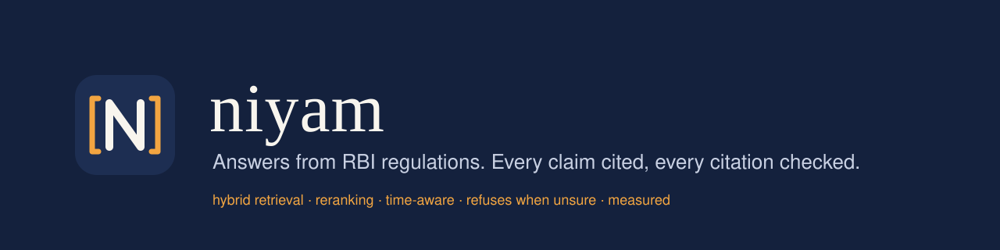
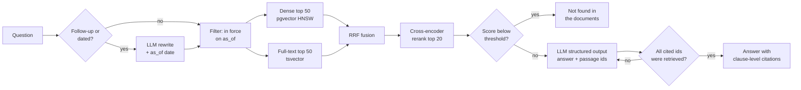

<p align="center">
  
</p>

<p align="center">
  
  
  
  
  
</p>

**Niyam** (नियम, "rule") answers questions about Reserve Bank of India Master Directions. Every
sentence in an answer links to the clause that supports it, every citation is checked on the
server before the answer is shown, and when the directions do not cover a question it says
*"Not found in the documents"* instead of guessing. Ask about a past date and it answers from the
rules that were in force then.

It is built as a production service, not a notebook: a polite crawler with incremental updates,
hybrid retrieval in Postgres, a cross-encoder reranker, a refusal gate, structured generation
with citation validation, an evaluation harness with ablations and a calibrated LLM judge, a
streaming web UI, Docker, Terraform for GCP and CI that fails when retrieval quality drops.

---

## Contents

- [Why this is hard](#why-this-is-hard)
- [How it works](#how-it-works)
- [Results](#results)
- [Quick start](#quick-start)
- [Using it](#using-it)
- [Evaluation](#evaluation)
- [Project layout](#project-layout)
- [Configuration](#configuration)
- [Deployment](#deployment)
- [Limitations](#limitations)
- [Documentation](#documentation)

## Why this is hard

RBI Master Directions are a good stress test for retrieval-augmented generation:

- **They are long and deeply structured.** A single direction runs to hundreds of numbered
  paragraphs, nested sub-clauses `(1)`, `(a)`, `(i)`, provisos, explanations and tables. Cutting
  them into fixed-size pieces separates conditions from the rules they qualify.
- **Exact terms matter.** Questions mention reference numbers (`DOR.AML.REC.No.88/14.01.002/2025-26`),
  paragraph numbers and acronyms (CDD, EDD, CKYCR) that embedding search tends to blur.
- **They change over time.** Directions are amended in place and withdrawn. The 2016 KYC
  direction is still online, carries an "Updated as on August 14, 2025" note, and was withdrawn
  on 4 December 2025 in favour of ten entity-specific 2025 directions. A system that ignores
  this gives confident answers from repealed rules.
- **Wrong answers are expensive.** For a compliance analyst, an uncited or invented limit is
  worse than no answer.

## How it works



**Ingestion.** The crawler reads the Master Directions index on rbi.org.in, waits two seconds
between requests, caches every response, and retries only transient errors. For each direction
it extracts the reference numbers, issue date, every amendment date and the withdrawal marker,
then parses the body into headings, clauses, restored list numbering and tables. A
structure-aware chunker keeps each numbered paragraph together with its sub-clauses and provisos
and records the heading path and anchor, so a citation opens the exact clause on the official
page. Unchanged documents and chunks are skipped on re-ingest, and their embeddings are reused.

**Retrieval.** Dense search (bge-small, HNSW) and Postgres full-text search run in parallel and
are fused with reciprocal rank fusion. A cross-encoder rescores the top 20. All of it runs inside
one Postgres and local ONNX models: no vector database to operate and no per-query embedding
cost.

**Refusal.** If the best reranker score is below a threshold tuned on the dev split of the
golden set, the answer is "Not found in the documents" and the LLM is never called.

**Generation.** Claude (`claude-opus-5-5` by default; OpenAI and Gemini are drop-in) receives up
to eight labelled passages with their reference number, date and status, and returns
`{answerable, answer, citations}` through structured output. The server rejects any answer that
cites a passage it was not given, retries once with the specific problems, and refuses if the
second attempt also fails. Unchecked text is never streamed to the user.

**Time.** Each question has an `as_of` date (today unless the user sets one or the rewriter
detects "in 2020"). Retrieval only returns directions issued by then and not yet withdrawn.
Withdrawn and partly repealed sources are labelled in the answer.

The design and the reasons behind each choice are in [docs/architecture.md](docs/architecture.md)
and [docs/decisions.md](docs/decisions.md).

## Results

### RBI golden set

The headline table comes from `niyam eval run` on the hand-checked RBI golden set
(`evals/golden.jsonl`, test split). The golden set is being built and verified question by
question with the tools described in [Evaluation](#evaluation); numbers are published here only
once they come from that set, never estimated.

| Config | Recall@5 | MRR | Faithfulness | Refusal F1 | p95 latency | Cost/query |
|---|---|---|---|---|---|---|
| Dense only, fixed chunks | pending | pending | pending | pending | pending | pending |
| Dense, structure-aware chunks | pending | pending | pending | pending | pending | pending |
| Hybrid (dense + full-text, RRF) | pending | pending | pending | pending | pending | pending |
| Hybrid + reranker | pending | pending | pending | pending | pending | pending |
| Hybrid + reranker + query rewrite | pending | pending | pending | pending | pending | pending |

Reproduce with:

```bash
niyam eval run -n dense-fixed -n dense-structure -n hybrid -n hybrid-rerank --split test
niyam eval run --mode full -n hybrid-rerank -n hybrid-rerank-rewrite --split test
```

### What has been measured so far

- **CI smoke set.** On the synthetic fixture corpus (6 documents, 34 questions including 6
  unanswerable and 3 dated), every retrieval configuration reaches 100% recall@5. The set is
  deliberately easy: it exists to catch regressions, not to compare configurations. Its useful
  signal is refusal: with the cross-encoder score, refusal F1 is 0.91 at the default threshold,
  while cosine similarity from bge embeddings never drops below the default threshold, so
  dense-only configurations refuse nothing until their threshold is tuned. CI fails if
  recall@5 falls below 0.95 or the reranked refusal F1 falls below 0.8.
- **Real corpus spot check.** With six KYC directions ingested (five 2025 entity-specific
  directions and the withdrawn 2016 one), "How often must periodic updation of KYC be carried
  out for high risk customers?" returns paragraph 42 of the 2025 directions. The same question
  dated 2020-06-30 returns only the 2016 direction. An out-of-scope question (TDS on deposit
  interest) gets a top reranker score of 0.00 and is refused before any LLM call.
- **Latency.** Both retrievers answer in tens of milliseconds. The CPU cross-encoder dominates:
  3 to 9 s for 20 to 30 real passages on a laptop. See [decisions.md](docs/decisions.md#4-reciprocal-rank-fusion-then-a-cross-encoder)
  for the options.

## Quick start

Requirements: Docker, or Python 3.11+ with [uv](https://docs.astral.sh/uv/) and Node 22.

```bash
git clone https://github.com/Neelpatel11/niyam-rbi-regulatory-rag-pipeline.git niyam && cd niyam
cp .env.example .env            # set ANTHROPIC_API_KEY
docker compose up --build -d    # Postgres + API on :8000 + UI on :3000

# load some directions (about 2 s per page; the cache makes re-runs free)
docker compose exec api niyam ingest rbi --match "Know Your Customer|Digital Lending|Fraud" --limit 30
docker compose exec api niyam embed
```

Open <http://localhost:3000>.

Without Docker:

```bash
uv sync --all-extras --group dev
docker compose up -d db          # or any Postgres 16+ with pgvector
uv run niyam init-db
uv run niyam ingest rbi --limit 30 && uv run niyam embed
uv run niyam serve               # API on :8000
cd web && npm install && npm run dev
```

No API key? Set `NIYAM_LLM_PROVIDER=extractive` to run the whole pipeline with an offline
stand-in that quotes the best-matching sentence. Retrieval, refusal and citations still work.

## Using it

**Command line**

```bash
niyam ask "What is the cooling-off period for digital loans?"
niyam ask "What were the small account limits?" --as-of 2020-06-30
niyam ask "..." --json
```

**HTTP API** (OpenAPI docs at `/docs`)

```bash
curl -s localhost:8000/v1/ask -H 'Content-Type: application/json' \
  -d '{"question": "How often must KYC be updated for high risk customers?"}'
```

```json
{
  "status": "answered",
  "answer": "Periodic updation must be carried out at least once every two years for high risk customers [S1].",
  "citations": [
    {
      "label": "S1",
      "title": "Reserve Bank of India (Commercial Banks – Know Your Customer) Directions, 2025",
      "circular_no": "DOR.AML.REC.No.88/14.01.002/2025-26",
      "clause_ref": "42",
      "url": "https://www.rbi.org.in/Scripts/BS_ViewMasDirections.aspx?id=13141#...",
      "withdrawn_on": null,
      "amended_after_as_of": false
    }
  ],
  "timings_ms": {"embed_query": 20, "dense_search": 30, "lexical_search": 40, "rerank": 3400, "generate": 2900, "total": 6500},
  "cost_usd": 0.0123
}
```

The response shape is real; the numbers above are illustrative.

| Endpoint | Purpose |
|---|---|
| `POST /v1/ask` | Answer with citations, sources, timings, token usage and cost |
| `POST /v1/ask/stream` | Server-sent events: `status`, `sources`, then the validated `answer` |
| `POST /v1/feedback` | Thumbs up or down for a `trace_id` |
| `GET /v1/documents` | Ingested directions with issue, amendment and withdrawal dates |
| `GET /v1/stats` | Corpus size and active models |
| `GET /healthz`, `/readyz` | Liveness and database readiness |

## Evaluation

The evaluation is the core of the project. Full methodology: [docs/evaluation.md](docs/evaluation.md).

**Golden set.** 150 to 300 questions across five categories: single fact (35%), multi-clause
(20%), numbers and tables (15%), time-sensitive (10%) and unanswerable (20%). Each answerable
item stores verbatim evidence quotes rather than chunk IDs, so the same set scores every
chunking strategy fairly. A stable hash splits items into dev (threshold tuning) and test
(reported numbers).

**Metrics.**

| Area | Metrics |
|---|---|
| Retrieval | recall@5, recall@20, hit@5, MRR, nDCG@10 |
| Generation | faithfulness (claims supported by their citations), correctness against the reference, citation precision |
| Refusal | precision, recall and F1 on the unanswerable class, false refusal rate |
| Operations | p50 and p95 latency, tokens and cost per query |

**Tooling.**

```bash
niyam eval draft --n 60 --unanswerable 20     # LLM drafts candidates from sampled chunks
niyam eval review                             # a person accepts, edits or rejects each one
niyam eval validate                           # composition by category and split
niyam eval tune -n hybrid-rerank              # refusal threshold that maximises F1 on dev
niyam eval run -n hybrid -n hybrid-rerank --split test
niyam eval run --mode full -n hybrid-rerank --split test
niyam eval label --results evals/results/<run>.json   # blind human labels
niyam eval calibrate --results evals/results/<run>.json  # judge agreement and Cohen's kappa
```

Every run writes a JSON file with the configuration, environment, per-question results and
per-category breakdowns, plus a Markdown table, and records itself in the `eval_runs` table.

**The judge is checked, not trusted.** `niyam eval calibrate` compares the LLM judge with blind
human labels on the same answers and writes agreement, Cohen's kappa and confusion matrices to
`evals/judge_calibration.md`. Use a judge model different from the generator
(`NIYAM_JUDGE_MODEL`).

## Project layout

```
niyam/
├── src/niyam/
│   ├── ingest/        fetcher (polite, cached), RBI index and page parsers, PDF and Markdown
│   │                  loaders, structure-aware and fixed chunkers, ingestion pipeline
│   ├── retrieval/     dense and full-text search, time filter, RRF, cross-encoder, retriever
│   ├── generation/    LLM clients (Anthropic, OpenAI, Gemini, offline), prompts, citation
│   │                  validation, query rewriting, pricing
│   ├── evals/         golden set schema, metrics, judge, runner, curation and calibration
│   ├── api/           FastAPI app, schemas, SSE streaming, rate limiting, API keys
│   ├── db/            schema, connection pool, repository
│   ├── qa.py          the query pipeline
│   └── cli.py         `niyam` command
├── web/               Next.js UI: streaming answers, citation chips, source cards, feedback
├── evals/             ablation configs, smoke set, results
├── tests/             unit and integration tests, synthetic fixture corpus
├── infra/terraform/   Cloud Run, Cloud SQL, Secret Manager, Scheduler, Artifact Registry
├── docs/              architecture, decisions, evaluation, operations, failures
└── .github/workflows  lint, types, tests, gated smoke evaluation, web build, image build
```

## Configuration

All settings are environment variables with the `NIYAM_` prefix (see
[`.env.example`](.env.example) and `src/niyam/config.py`). The ones you are most likely to change:

| Variable | Default | Notes |
|---|---|---|
| `NIYAM_LLM_PROVIDER` / `NIYAM_LLM_MODEL` | `anthropic` / `claude-opus-5-5` | `openai`, `gemini`, `extractive` |
| `NIYAM_LLM_EFFORT` | `medium` | Reasoning effort for generation |
| `NIYAM_EMBEDDING_PROVIDER` / `NIYAM_EMBEDDING_MODEL` | `fastembed` / `BAAI/bge-small-en-v1.5` | `openai`, `gemini` supported |
| `NIYAM_CHUNK_SET` | `structure-v1` | `fixed-512` for the baseline |
| `NIYAM_RERANK_MODEL` | `Xenova/ms-marco-MiniLM-L-6-v2` | `BAAI/bge-reranker-v2-m3-int8` for higher quality |
| `NIYAM_REFUSAL_THRESHOLD` | `0.15` | Tune with `niyam eval tune` |
| `NIYAM_API_KEYS` | none | Bearer keys required by the API when set |
| `NIYAM_RATE_LIMIT_PER_MINUTE` | `30` | Per client, per instance |
| `NIYAM_LANGFUSE_ENABLED` | `false` | Traces each question with rewrite, retrieval and generation spans |

## Deployment

`infra/terraform` provisions Artifact Registry, Cloud SQL for PostgreSQL 16 with pgvector,
Secret Manager, the API and web on Cloud Run, the ingestion job as a Cloud Run Job and a daily
Cloud Scheduler trigger. The API image bakes in the embedding and reranking models, so cold
starts download nothing. The Anthropic key is added to Secret Manager by hand and never enters
Terraform state. Step-by-step instructions, cost controls and monitoring queries are in
[docs/operations.md](docs/operations.md).

## Limitations

- **In-place amendments.** RBI updates Master Directions in place, so a question dated in the
  past is answered from the right documents but their current wording. Citations are flagged
  when a direction was amended after the requested date. Archiving each version at ingestion
  time would close this going forward.
- **Supersession links are only as good as the text.** Real 2025 directions repeal earlier
  instructions through a separate circular rather than by name, so "replaced by" links are not
  inferred for them. Withdrawal dates are captured and drive retrieval regardless.
- **Master Directions only.** Circulars and notifications are a different index on the site and
  are not ingested yet.
- **CPU reranking is slow.** See [Results](#results).
- **Keyword search is not BM25.** Postgres `ts_rank_cd` has no IDF term. See
  [decisions.md](docs/decisions.md#3-postgres-full-text-search-for-the-keyword-side-and-it-is-not-bm25).
- **Not legal advice.** Answers point to the official text; check it before acting.

## Documentation

| Document | Contents |
|---|---|
| [docs/architecture.md](docs/architecture.md) | Components, data model, query path, deployment diagram |
| [docs/decisions.md](docs/decisions.md) | Trade-offs behind each design choice |
| [docs/evaluation.md](docs/evaluation.md) | Golden set protocol, metric definitions, judge calibration, ablations |
| [docs/operations.md](docs/operations.md) | Local setup, ingestion, GCP deployment, cost controls, monitoring |
| [docs/failures.md](docs/failures.md) | What broke during development and how it was fixed |

## Data and licence

The code is MIT licensed. Regulatory text is fetched at run time from rbi.org.in and is not
redistributed in this repository. The documents in `tests/fixtures/corpus` are synthetic and are
not RBI text.
