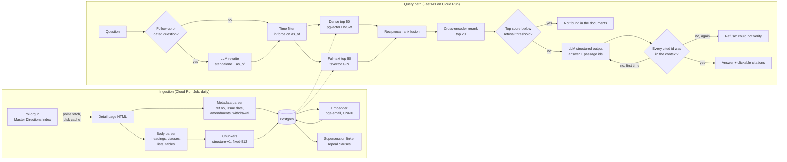
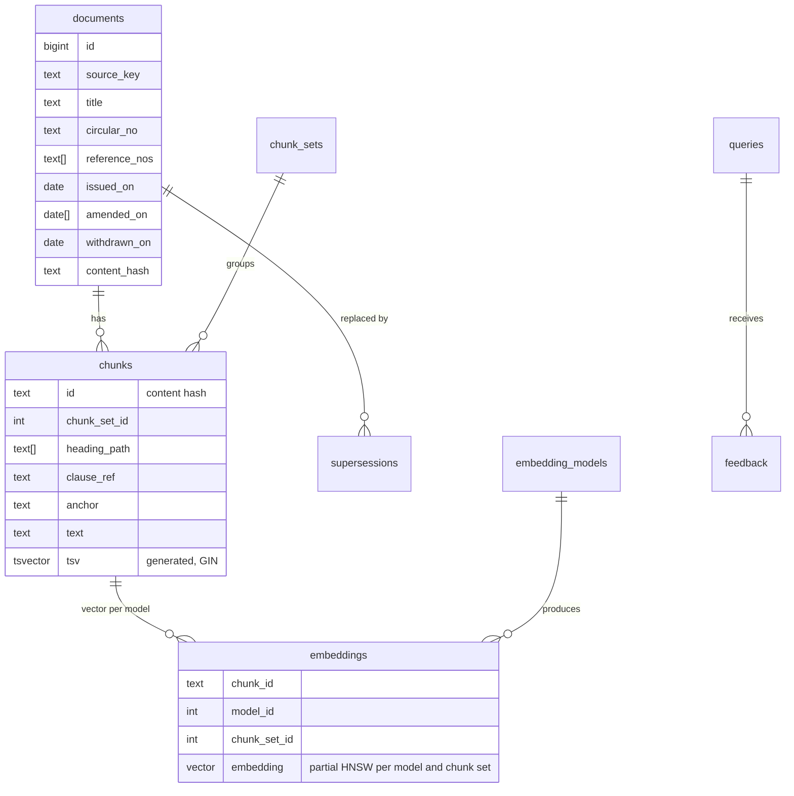
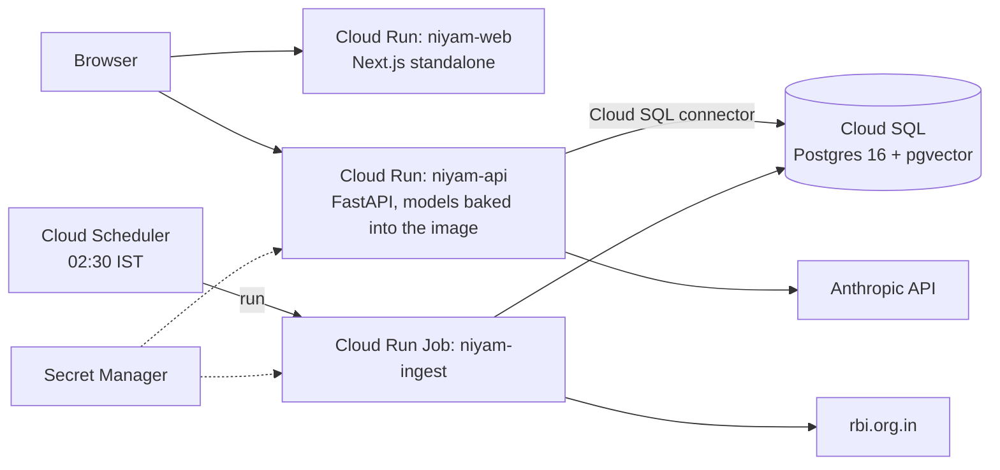

# Architecture

Niyam has two paths: an offline ingestion path that turns RBI Master Directions into searchable
passages, and an online query path that answers a question from those passages and checks every
citation before the user sees it.

## System overview

## Ingestion

| Step | Module | Notes |
|---|---|---|
| Fetch | `ingest/fetcher.py` | Per-host spacing (2 s default), retries only on 429/5xx and transport errors, content-addressed disk cache so re-runs are free. |
| Index page | `ingest/rbi.py` | Walks the Master Directions table, tracking department and listing date headers. Deduplicates entries that appear under several departments. |
| Metadata | `ingest/rbi.py` | Reference numbers (`RBI/DOR/2025-26/169`, `DOR.AML.REC.No.88/...`), issue date, every "Updated as on" date, and the withdrawal marker RBI renders as a background image (`Withdrawn04122025.jpg`). |
| Body | `ingest/html.py` | Headings from `p.head` and bold paragraphs, anchors from `<a id>`, clause numbers from the text, `<ol type="a|i|1">` numbering restored, footnote `` markers removed, tables converted to Markdown, table-of-contents tables dropped. |
| Local files | `ingest/local.py` | Markdown with YAML front matter, or a PDF plus a sidecar `.yaml`. The PDF parser (`ingest/pdf.py`) drops repeated headers and footers, detects headings by font size and weight, and keeps tables whole. |
| Chunking | `ingest/chunking.py` | See below. |
| Storage | `db/repository.py` | Chunk IDs are content hashes, so an unchanged paragraph keeps its ID and its embedding across re-ingests. |
| Embedding | `embeddings.py` | Only chunks without a vector for the chosen model are embedded. The embedded text is `title + heading path + body`. |
| Supersession | `db/repository.py` | A document is linked to a newer one when its reference number appears inside the newer one's repeal provisions. |

### Chunking

`structure-v1` turns elements into *units*: a numbered clause plus its sub-clauses and provisos,
or a whole table. Units are packed into chunks under the same heading path up to a target of 450
tokens and a hard cap of 800. Sections smaller than 120 tokens merge with their neighbours inside
the same chapter. A clause longer than the cap is split on sentence boundaries with a 60-token
overlap; a long table is split by rows and every part repeats the header row.

`fixed-512` is the baseline: the document flattened to words, cut into 512-token windows with a
64-token overlap, with no heading information.

Both chunk sets live side by side in the same tables, so a single database can run every ablation.

## Data model

The `embeddings.embedding` column has no fixed dimension. Each (model, chunk set) pair gets its
own partial HNSW index over `embedding::vector(dim)`, created on first use, so 384-dimension
and 1536-dimension models can be compared without schema changes.

## Query path

1. **Rewrite (conditional).** Only follow-ups and questions that mention a time ("in 2020",
   "before", "previously") go to the LLM. It returns a standalone question and an optional
   `as_of` date. Other questions skip this call, which saves one round trip on most traffic.
2. **Time filter.** Documents must be in force on `as_of` (today by default): issued on or
   before it and not withdrawn by then. "Include withdrawn" lifts the second condition.
3. **Hybrid retrieval.** Dense (cosine over HNSW, `ef_search = 100`) and full-text (`ts_rank_cd`
   over a weighted `tsvector`, OR semantics) run concurrently and are fused with reciprocal rank
   fusion (`k = 60`).
4. **Rerank.** A cross-encoder scores the top 20 fused candidates. Its sigmoid score is the
   refusal signal.
5. **Refusal gate.** If the best score is under the tuned threshold, the answer is "Not found in
   the documents" and no generation call is made.
6. **Generation.** Up to 8 passages within a 6,000-token budget go to the LLM, labelled
   `S1..S8` with title, reference number, issue date, status and section. The model returns
   `{answerable, answer, citations}` through structured output.
7. **Citation check.** Every `[S#]` marker must name a passage that was in the context and must
   appear in the `citations` list. On failure the request is retried once with the problems
   spelled out; a second failure becomes a refusal.
8. **Response.** Citations resolve to the official page plus the clause anchor. Each carries the
   document's status and a flag when the direction was amended after `as_of`.
9. **Record.** The query, configuration, timings, token usage and cost are written to `queries`
   and, when enabled, traced in Langfuse. Feedback attaches to the trace ID.

The streaming endpoint sends `status` and `sources` events as the stages complete, and the answer
only after the citation check. Unchecked text is never streamed to the user.

## Deployment

Terraform for all of this is in `infra/terraform`. See [operations.md](operations.md).
